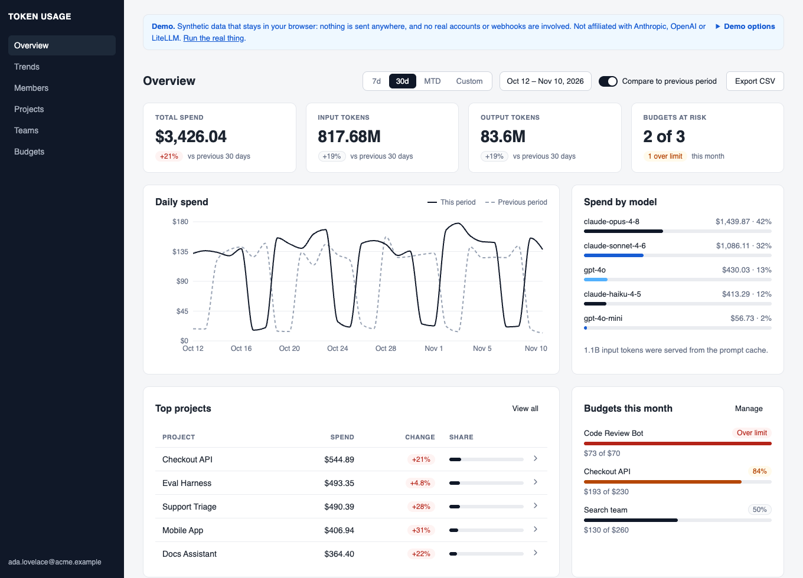
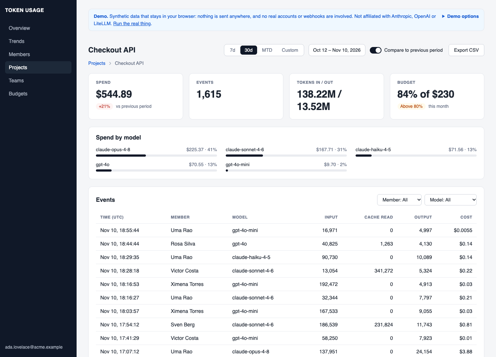
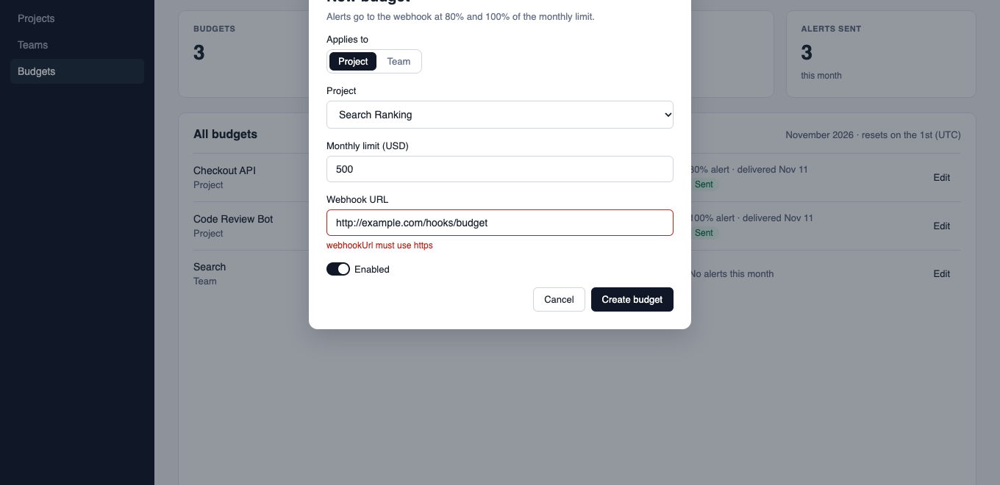

<h1 align="center">Token Usage Tracker</h1>

<p align="center">
  <b>Know who spent what on LLMs, before the invoice arrives.</b><br>
  Report token usage from any app. Get priced, per-team spend, a dashboard, and budget alerts.
</p>

<p align="center">
  <a href="https://github.com/ilker-ekin/token-usage-tracker/actions/workflows/ci.yml"></a>
  <a href="LICENSE"></a>
  
  
  
  
</p>

<p align="center">
  <a href="https://ilker-ekin.github.io/token-usage-tracker/"><b>Live demo</b></a> &middot;
  <a href="#quick-start-docker-only">Quick start</a> &middot;
  <a href="#how-it-works">How it works</a> &middot;
  <a href="#design-decisions">Design decisions</a> &middot;
  <a href="#api-overview">API</a>
</p>

<p align="center">
  <a href="https://ilker-ekin.github.io/token-usage-tracker/"></a>
</p>

## What you get

- **Spend you can explain.** Per organization, team, project, model and member, with the previous period alongside.
- **Costs that never rewrite history.** Every event is priced at the moment it happens, prompt-cache tokens included.
- **Budgets with webhooks.** A monthly cap per project or team, with an alert at 80% and again at 100%.
- **Safe to retry.** An idempotency key turns a repeated request into a no-op.
- **Multi-tenant by design.** The organization always comes from the token, never from the request.
- **Tested against the real thing.** About 150 backend tests run on throwaway Postgres and Redis containers, concurrency and Redis-down cases included.

## Try it

| | |
|---|---|
| **Nothing to install** | Open the **[live demo](https://ilker-ekin.github.io/token-usage-tracker/)**. It is the real dashboard on generated data, running entirely in your browser: nothing is sent anywhere. Use *Demo options* to view it as a member, make the server fail, or see the session-ended dialog. |
| **One command** | `docker compose up --build`, then open http://localhost:3000 and sign in as `member1@acme.dev` with the password `seed-password`. |

## A closer look

| Project drill-down | Budgets with the API's validation |
|---|---|
|  |  |

## Why it is interesting to read

- **Money is handled carefully.** `BigDecimal` end to end, one rounding step, and prices versioned by validity so history is stable.
- **Concurrency is designed, not hoped for.** One `INSERT ... ON CONFLICT` upsert per ingest, advisory locks for first-time prices, `SKIP LOCKED` for the webhook outbox, and a test that fires 50 parallel ingests.
- **Caching without stale reads.** Invalidation is a single Redis `INCR`, with no `KEYS` or `SCAN`, and Redis being down never fails a request.
- **Security choices are explicit.** An HttpOnly cookie with a CSRF header instead of `localStorage`, rate-limited login that does not reveal which emails exist, and SSRF checks on webhook URLs.
- **Honest about its limits.** The [limitations list](#limitations--next-steps) says what is not done yet.

Details for each of these are in [Design decisions](#design-decisions).

## How it works

```
                  ┌───────────────────────── API (Spring Boot) ──────────────────────────┐
 your app ──────▶ │ POST /usage                                                          │
 (clients/)       │   1. auth: member + org from JWT; project must belong to that org    │
                  │   2. price the event at event time (model_pricing, LiteLLM fallback) │
                  │   3. one transaction:  INSERT usage_event                            │
                  │                        UPSERT daily / weekly / monthly rollups ──────┼──▶ PostgreSQL
                  │   4. after commit:     INCR cache version for the org ───────────────┼──▶ Redis
                  │                                                                      │
 dashboard ─────▶ │ GET /analytics/*  ── read-through cache ── Redis hit? ─ else rollups │
 (ui/, nginx)     │ GET /usage        ── raw events, org-scoped, paginated               │
                  │                                                                      │
                  │ 02:30 UTC job: rebuild the last 2 days of rollups from usage_event   │
                  └──────────────────────────────────────────────────────────────────────┘
```

1. An application makes an LLM call and reads the token counts from the response.
2. It reports them to `POST /usage`. The tracker looks up the model's price **at that moment** and stores the event with its cost — so later price changes never rewrite history.
3. Daily, weekly, and monthly summary rows (rollups: one table, keyed by granularity and model) are updated in the same transaction.
4. The dashboard reads those summaries through a short-lived Redis cache.
5. Once a minute, a job compares each budget with its month-to-date spend and queues a webhook alert at 80% and 100%.

## Tech stack

| Layer | Technology |
|---|---|
| API | Java 21, Spring Boot 4.1, Maven |
| Database | PostgreSQL (Flyway migrations) |
| Cache | Redis |
| Auth | JWT (email + password login); an HttpOnly cookie for the dashboard, Bearer for scripts |
| Dashboard | React 19, React Router 7, Recharts, Vite 8, TypeScript (`ui/`); Vitest for its tests |
| Tests | JUnit + Testcontainers (real Postgres/Redis in Docker) |
| CI | GitHub Actions; Dependabot for Maven, npm, Actions and Docker |

## Getting started

### Quick start (Docker only)

```bash
docker compose up --build
```

Open http://localhost:3000 and log in with the demo accounts below. This builds the API and dashboard images, starts PostgreSQL and Redis, and seeds a demo org on first start. The API is also exposed on http://localhost:8080 for `curl` or the `clients/` CLI. `docker compose down -v` removes everything, including the demo data.

### Local development

**Prerequisites:** Docker Desktop (running), Java 21, Node.js 22+.

```bash
# 1. Start PostgreSQL and Redis
cd token-usage-tracker
docker compose up -d

# 2. Start the API with demo data (1 org, 10 members, 500 events)
./mvnw spring-boot:run -Dspring-boot.run.profiles=dev,local

# 3. Start the dashboard (new terminal)
cd ../ui
npm install
npm run dev
```

Open http://localhost:5173 and log in:

| Email | Password | Role |
|---|---|---|
| `member1@acme.dev` | `seed-password` | Admin |
| `member2@acme.dev` … `member10@acme.dev` | `seed-password` | Member |

You should see 30 days of demo spend (on port 3000 for the Docker quick start).

### The dashboard

| Page | What it shows |
|---|---|
| Overview | KPI cards with change against the previous period, daily spend, spend by model, budgets at risk (admins only) |
| Trends | Daily series for the range, with the previous period overlaid |
| Members, Teams, Projects | Ranked tables; a project opens its drill-down (`/projects/<id>`) with a model breakdown and filterable, paginated raw events |
| Budgets (admins, `/admin/budgets`) | Budgets with month-to-date spend, a create/edit dialog that shows the API's field errors, and each budget's alert history |

- The date range (`?range=7d|30d|mtd|custom`, `from`, `to`, `compare=0`) lives in the URL, so any view can be bookmarked or shared.
- Every page has loading, error (with retry) and empty states. Tables export to CSV; the project page exports every event in the range, up to 20,000.
- If the session expires, a dialog signs you in again without leaving the page, and the open view reloads its data.
- The screens were designed in Figma first. The layout is desktop-first and has been checked in Chrome only.

### The demo build

<details>
<summary>How the static demo works</summary>

`cd ui && npm run build:demo` builds the same dashboard in demo mode (`vite --mode demo`, output in `ui/dist-demo`). A single check on `VITE_DEMO` in `ui/src/api.ts` sends every request to `ui/src/demo/handler.ts` instead of the network. That module answers the same paths, shapes, sorting, validation messages and error statuses from a seeded generator of synthetic data (`ui/src/demo/data.ts`): 28 people, 9 projects, 5 teams and 5 models over 90 days, at illustrative prices. The flag is replaced at build time, so the normal build contains none of this code; CI checks that. The demo uses hash routes and a `/token-usage-tracker/` base path because GitHub Pages has no fallback for client-side routes, and `.github/workflows/pages.yml` publishes it from `main`. After forking, enable it under *Settings > Pages > Source: GitHub Actions*.

</details>

## API overview

Every endpoint, with examples for reporting events, idempotency, prompt-cache tokens and budgets.

<details>
<summary>Show the API reference</summary>

All endpoints require authentication except login, logout and health. Programmatic clients send `Authorization: Bearer <token>` with the token from `POST /auth/token`. The dashboard uses the `tut_session` cookie that the same call sets instead (HttpOnly, SameSite=Strict, Secure unless `AUTH_COOKIE_SECURE=false`), so no script on the page can read the token. A write authenticated by that cookie must also carry an `X-Requested-With` header, which another site cannot add; without it the API answers `403`. `POST /auth/logout` clears the cookie.

| Endpoint | What it does |
|---|---|
| `POST /auth/token` | Log in — returns a JWT |
| `POST /auth/logout` | Clear the dashboard session cookie |
| `GET /auth/me` | Who am I (from the token) |
| `GET /analytics/directory` | Every project, team and member of the org, for pickers and filters |
| `POST /usage` | Report a usage event (tokens in/out, cache tokens, model, project) |
| `GET /usage` | Browse raw events, filterable by member, project, model and time, paginated |
| `GET /analytics/projects` | Spend per project for a date range |
| `GET /analytics/members` | Spend per member (top spenders first) |
| `GET /analytics/teams` | Spend per team |
| `GET /analytics/daily` | Day-by-day time series |
| `GET /analytics/models` | Spend per model, optionally for one project (`projectId`) |
| `GET /analytics/summary` | Totals for the range and for the previous range of equal length |
| `POST /model-pricing` | Add a model price (admin only) |
| `GET /model-pricing` | List model prices |
| `POST /budgets` | Create a monthly spend cap for a project or team (admin only) |
| `GET /budgets` | List budgets with month-to-date spend (admin only) |
| `PUT /budgets/{id}` | Change limit, webhook URL or enabled flag (admin only) |
| `DELETE /budgets/{id}` | Delete a budget and its alert history (admin only) |
| `GET /budgets/{id}/alerts` | Alerts raised for a budget and their delivery status (admin only) |

Example — report an event:

```bash
curl -X POST http://localhost:8080/usage \
  -H "Authorization: Bearer $TOKEN" \
  -H "Content-Type: application/json" \
  -H "Idempotency-Key: $(uuidgen)" \
  -d '{"projectId":"<uuid>","model":"claude-opus-4-8","inputTokens":1200,"outputTokens":450,"eventTime":"2026-07-07T12:00:00Z"}'
```

`inputTokens` is uncached input only. Prompt-cache usage goes in the optional `cacheReadTokens` and `cacheCreationTokens` fields (default 0), which are priced at the model's cache rates:

| Provider | `inputTokens` | `cacheReadTokens` | `cacheCreationTokens` |
|---|---|---|---|
| Anthropic | `usage.input_tokens` | `usage.cache_read_input_tokens` | `usage.cache_creation_input_tokens` |
| OpenAI | `prompt_tokens - prompt_tokens_details.cached_tokens` | `prompt_tokens_details.cached_tokens` | not billed, send 0 |

OpenAI's `prompt_tokens` already includes cached tokens, so subtract them or they are charged twice. `POST /model-pricing` takes optional `cacheReadPricePer1k` and `cacheCreationPricePer1k`. A pricing row without them charges cache tokens at the input price.

Send an optional `Idempotency-Key` header (1 to 255 characters, unique per org) to make a retry safe. The first request returns `201`. A repeat with the same key returns `200` with the original event and books nothing: no second event, no rollup change. The body of a repeat is not compared with the original, so use a fresh key for every distinct event.

Model prices are seeded from [LiteLLM's public catalog](https://github.com/BerriAI/litellm); unknown models are priced from the same catalog automatically on first use.

Ingest rejects events that cannot be real with a `400` naming the field: more than 100,000,000 tokens or 10,000,000 lines in one event, a model id over 100 characters, an `eventTime` more than 5 minutes ahead of the server or older than 90 days (`INGEST_MAX_FUTURE`, `INGEST_MAX_EVENT_AGE`). An unknown model is a `422`. If the model is unknown and the catalog cannot be reached within its timeout, the answer is a `503`: retry the same request later.

### Budgets and alerts

A budget caps what one project or one team may spend in a calendar month (UTC):

```bash
curl -X POST http://localhost:8080/budgets \
  -H "Authorization: Bearer $TOKEN" \
  -H "Content-Type: application/json" \
  -d '{"scopeType":"PROJECT","scopeId":"<project uuid>","monthlyLimitUsd":500,"webhookUrl":"https://example.com/hooks/budget"}'
```

Once a minute the tracker compares each enabled budget with its month-to-date spend. When spend reaches 80% and again at 100% of the limit, it POSTs this JSON to the budget's webhook, once per threshold per month:

```json
{"alertId":"<uuid>","budgetId":"<uuid>","scopeType":"PROJECT","scopeId":"<uuid>","periodStart":"2026-11-01","thresholdPct":80,"spendUsd":412.37,"limitUsd":500.00}
```

- Any 2xx answer counts as delivered. Anything else is retried on the next run, up to 5 attempts, then the alert is marked `FAILED`.
- Delivery is at-least-once; use `alertId` to drop a repeat.
- Webhook URLs must be `https` and must not resolve to a private, loopback or link-local address. Redirects are not followed. Set `BUDGET_ALLOW_INSECURE_WEBHOOK_URLS=true` for local development only.
- A team budget counts events by the team the member was in when the event was ingested. Spend by members without a team counts toward no team budget.
- Alerts only notify. Ingest is never blocked by a budget.

</details>

## Try it with real Claude calls (optional)

`clients/` contains a small CLI that asks Claude a question and automatically reports the request's real token usage to the tracker:

```bash
cd clients
cp .env.example .env    # then fill in the values — the file explains each one
npm install
npm run ask             # chat mode: every message is answered and tracked
npm run ask -- "one-off question"
npm run verify -- --live   # proves tracker costs match Anthropic's own usage numbers
```

Requires an [Anthropic API key](https://platform.claude.com). `.env` is gitignored, so your key stays on your machine.

## Design decisions

**Cost is snapshotted at ingest.** Each event stores the cost computed from the price that was valid at `eventTime`. Prices are versioned (`valid_from` / `valid_to`), so adding a new price never changes what past usage cost. Unknown models are priced once from LiteLLM's catalog and persisted. That lookup is a network call, so it runs before the ingest transaction starts, with a 2 s connect and 5 s read timeout, and the downloaded catalog is reused for 10 minutes. A slow or failing catalog never holds a database connection.

**Rollups are written in the ingest transaction and recomputed nightly.** The dashboard never aggregates raw events. It sums pre-aggregated rows (one table, with a `granularity` of day, week or month and the model in the key), and an event and its rollups commit together or not at all. A 02:30 UTC job rebuilds the last two days (plus their weeks and months) from `usage_event`, the source of truth, as a safety net.

**Concurrency is handled with upserts.** An ingest writes its day, week and month rollup rows with one three-row `INSERT … ON CONFLICT DO UPDATE SET total = total + EXCLUDED.total`, so parallel ingests for the same member, project and day can't collide on insert or lose an increment. It's backed by a test that fires 50 ingests at once. The unique key is `NULLS NOT DISTINCT` because `team_id` is nullable. With a plain `UNIQUE`, members without a team got one row per event. The nightly job takes a `SHARE ROW EXCLUSIVE` table lock, so ingests queue for its few seconds instead of racing its delete-and-rebuild.

**The read-through cache is evicted by version.** Analytics responses are cached for 5 minutes under keys that embed a per-org version and a global generation. An ingest invalidates its org with one `INCR` after commit, and the nightly job invalidates every org by bumping the generation. There is no `KEYS`/`SCAN`, and a read racing a write can't re-cache stale totals: the reader resolves the version before it queries. If Redis is down, the cache becomes a pass-through and no request fails.

**Login is rate limited in Redis.** `POST /auth/token` counts failed logins per email (5) and per client address (20) in a 15-minute window, then answers `429` with `Retry-After`; a successful login clears the email's counter. If Redis is down the limit is skipped rather than blocking every login. An unknown email costs the same bcrypt comparison as a wrong password, so response time doesn't reveal which emails have an account. The client address is taken from `X-Forwarded-For` only when the request comes from a private-network proxy such as the bundled nginx.

**Tenant isolation comes from the token.** The org always comes from the JWT (or from the member row on ingest), never from request parameters. Every query is filtered by it. Ingest rejects a project from another org with the same 404 as an unknown project, so tenants can't probe each other's ids. Tests cover each endpoint against a second org's data.

## Limitations / next steps

<details>
<summary>The honest list: 11 known limitations</summary>

- **Budget alerts are unsigned and coarse.** Webhook requests carry no signature, so a receiver cannot prove they came from the tracker. Thresholds are fixed at 80% and 100%, the period is always a calendar month, and changing a limit mid-month does not retract or re-send alerts already raised for that month.
- **One cache-write rate per model.** Anthropic bills 1-hour cache writes at 2x input and 5-minute writes at 1.25x. The tracker stores a single cache-creation price (the 5-minute rate from LiteLLM), so 1-hour writes are under-billed. Costs booked before cache tokens were tracked separately are not recomputed.
- **Model pricing is global.** `model_pricing` is shared by all orgs, and `POST /model-pricing` accepts the `ADMIN` role of *any* org. One customer's admin can therefore change prices for every tenant. A real deployment needs a separate operator role, or per-org price overrides.
- **Idempotency keys never expire and replays are not compared.** A key stays reserved in its org for as long as the event exists, and a repeat with a different body silently returns the original event instead of a `409`.
- **`/analytics/teams` omits team-less spend.** The query inner-joins `team`, so members without a team are missing from that view (they're still in the other views).
- **The recompute window is fixed at two days.** Events arriving later still update their rollups at ingest, but the nightly rebuild won't re-check them. The recompute query also filters `usage_event` on `event_time` alone, so it needs its own index, or monthly partitioning, as the table grows.
- **The recompute job blocks ingest briefly.** While it runs, ingest requests wait on its table lock (seconds at this data size). At larger scale it should rebuild into a staging table and swap, or recompute per org.
- **Cache version keys have no TTL.** That's one tiny key per org. If Redis evicted one under memory pressure, stale entries could be served until their 5-minute TTL expired.
- **The live demo is a mock, not the backend.** It shares the API's TypeScript types, so a changed response shape stops it compiling, but it does not exercise the server, the database or the cache. Its numbers are synthetic and its prices illustrative.
- **The dashboard has only been run in Chrome, at desktop width.** There are no narrow-screen layouts, and the loading states have not been checked in other browsers. The chart library (Recharts 2) is on its last maintained major version.
- **JWT claims live for the whole token lifetime.** A member moved to another org keeps the old org in their token for up to `JWT_TTL`, and there's no revocation list.

</details>

## Running the tests

```bash
cd token-usage-tracker
./mvnw test
```

Dashboard tests (the demo data and the in-browser API) run with `cd ui && npm test`. Docker must be running for the backend tests — they start their own throwaway Postgres and Redis containers, so nothing you run locally is touched. Beyond the endpoint tests, the suite includes concurrency tests (parallel ingests and ingests racing the nightly job), cross-org isolation tests, and a run with Redis unreachable. The same suite runs in CI on every pull request, together with the dashboard's unit tests, type-check, normal build and demo build (`cd ui && npm run build`, `npm run build:demo`), and merging is blocked until both checks pass. A `changes` job looks at which files a pull request touches, so a UI-only change skips the backend tests and a backend-only change skips the UI build. A skipped check still counts as passing.

## Configuration

<details>
<summary>Environment variables</summary>

Everything is configured through environment variables (sensible localhost defaults for development):

| Variable | Default | Notes |
|---|---|---|
| `DB_URL` | `jdbc:postgresql://localhost:5432/token_usage` | |
| `DB_USERNAME` / `DB_PASSWORD` | `tut` / empty | Matches `docker-compose.yml` |
| `REDIS_HOST` / `REDIS_PORT` | `localhost` / `6379` | |
| `JWT_SECRET` | dev-only fallback | **Required in production** — the app refuses to start without it outside the `dev` profile |
| `JWT_TTL` | `PT12H` | Token lifetime |
| `AUTH_COOKIE_SECURE` | `true` (`false` in the `dev` profile and `docker-compose.yml`) | Set `false` only when serving the dashboard over plain HTTP |
| `LOGIN_MAX_FAILURES_PER_EMAIL` / `LOGIN_MAX_FAILURES_PER_IP` / `LOGIN_FAILURE_WINDOW` | `5` / `20` / `PT15M` | Login rate limit |
| `INGEST_MAX_FUTURE` / `INGEST_MAX_EVENT_AGE` | `PT5M` / `P90D` | Accepted `eventTime` window |
| `BUDGET_EVALUATION_INTERVAL` | `PT1M` | How often budgets are checked |
| `BUDGET_ALLOW_INSECURE_WEBHOOK_URLS` | `false` | Local development only |
| `LITELLM_PRICING_URL` | LiteLLM's public catalog | Source for unknown-model prices |

</details>

## Project layout

```
token-usage-tracker/   Spring Boot API (src/main/java/dev/ekin/tokenusage)
  ├─ auth/             JWT login, session cookie, rate limiter, token filter
  ├─ usage/            Event ingestion + drill-down
  ├─ pricing/          Model prices, cost calculation
  ├─ analytics/        Rollups, aggregate queries, directory, Redis cache
  ├─ budget/           Monthly spend caps, threshold alerts, webhook delivery
  └─ tenant/           Organizations, teams, members, projects
ui/                    React admin dashboard (+ nginx image for the Docker demo)
  ├─ src/pages/        One file per screen
  ├─ src/components/   Layout, KPI card, chart, table, dialogs
  ├─ src/api.ts        Typed API client; src/dateRange.tsx keeps the range in the URL
  └─ src/demo/         Generated data and in-browser API for the static demo build
clients/               Example CLI that calls Claude and reports usage
docker-compose.yml     Full demo stack: API, UI, PostgreSQL, Redis
```
